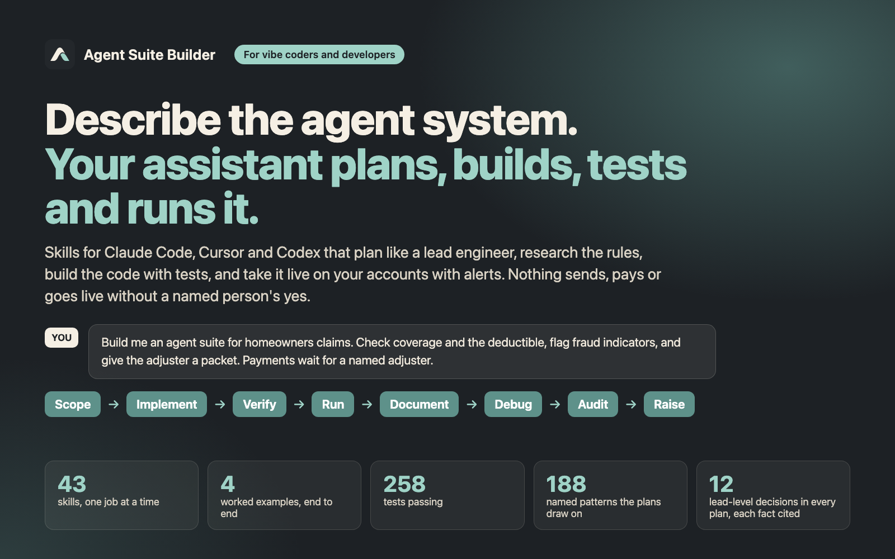

_For vibe coders and developers building AI agents. Your coding assistant plans, builds, stress-tests, runs, documents, debugs and audits agent systems with you, from a Slack/Gmail/Jira digest to an insurance-claims suite. Nothing sends, pays or goes live without a named person's yes._

**Who it's for.** Anyone building AI agents with Claude Code, Cursor, Codex CLI or another assistant that loads `SKILL.md` files — **vibe coders** who describe what they want and let the assistant do the coding, **developers**, or both together.

**What it does.** You describe the agent system you want in one sentence. Your coding assistant follows this pack's procedures and does the work in your project: a plan (`blueprint.md`), then code with tests that it runs itself, then a schedule on your own accounts with alerts and a trial week, and debug and audit reports when something goes wrong.

**Plans like a lead engineer.** The plan is not a to-do list. `blueprint.md` makes the 12 decisions a tech lead signs off before anyone builds: the outcome and how it is measured, what is out of scope, every data source and its access level, which kind of agent each step needs and the options it ruled out (with the reason), memory and retention, tools and permissions, the trigger, the output contract, seven layers of guardrails, who approves what, when it counts as done, and the release plan. Every outside fact is researched and cited. Raise holds an existing agent to the same lead standard on a 14-row scorecard.

**Vibe coding, fully supported.** At the start it asks one thing: will you build this yourself with it, or is a developer involved? In vibe mode it runs every command itself, explains each result in one plain sentence, and asks you only for decisions and for what only you can do — sign in to an account, approve a permission, say yes to go live. It never asks you to edit code, read an error trace or paste a password into chat. With a developer, it leaves reviewable code and a handoff file. Together, you vibe-code and a developer reviews at the gates. How it talks to you — outcome first, one decision at a time with its recommendation, errors explained as what happened, what it means and what it will do next, a checkpoint before every change — follows plain-language, UX-writing and learning-science research the pack cites.

**What it does not do.** It is not a hosted bot: the suite runs where you choose (your computer on a schedule, a CI schedule, or your cloud), on your own accounts. It connects nothing until you sign in and approve, and nothing sends, pays or files until a named person says yes. For money moving in production, regulated data at volume or many customers, it recommends a developer review and writes the handoff file for one.

**Try this first.** After unzipping the pack where your assistant can read it, open your coding assistant in your project and type:

> Use Agent Suite Builder. Connect Slack, Gmail, and Jira. Give me task updates.

You get `blueprint.md`: a 12-part plan you can read and argue with — the goal, what is out of scope, the data sources, the safety rules, and how you will know it works. When a decision is missing, the assistant asks you instead of guessing. Next, ask: "Implement the blueprint."

**Or give it something hard.** The pack's flagship example is a homeowners insurance claims suite in Texas: four agents take a claim e-mail through coverage, deductible and fraud-indicator checks to an adjuster packet, citing the claim-handling rules they researched. Payments and letters stay dry-runs until a named adjuster approves. It ships with the code, a planted bug and the Debug record that found it, and an Audit.

**The nine jobs**

1. **Start** (`using-agent-systems`) — picks the right job for your request and loads only that skill.
2. **Scope** (`scope-to-suite`) — turns a one-line request into `blueprint.md`.
3. **Implement** (`implement-agent-from-blueprint`) — writes code for one framework (for example LangGraph), one module per agent, plus a test that checks the output.
4. **Verify** (`verify-agent-suite`) — runs by itself after Implement: several independent testers try to break the suite at once (they follow the README from scratch, deliberately break every safety rule to prove a test catches it, attack the inputs and approvals, check the docs against the code, and walk it as you would). It fixes what they confirm, adds a test for each fix, and tests again. It also runs a **model council**: by default, reviewers on different models inside your own assistant, at no extra cost. If you ask, it adds other AI providers on your own keys, redacted, with a dry run and a cost cap first, and acts on nothing until it is reproduced. Nothing goes live without a Verify pass.
5. **Run** (`run-agent-suite`) — takes the tested suite live: picks where it runs, connects your accounts one at a time (read-only first, passwords never in chat), runs a dry-run trial week with alerts on, goes live only on a named yes with a one-command roll-back, and writes `RUNBOOK.md`.
6. **Document** (`document-agent-suite`) — writes the technical documentation for what it built, checked against the code: an architecture page, a card per agent (what it does, what it may touch, what it must never do), tools and permissions, operations with every alert and the roll-back, decision records, and a plain user guide.
7. **Debug** (`debug-failing-agent`) — takes one failing run, finds the first step that went wrong, fixes that step and adds a test so it stays fixed.
8. **Audit** (`audit-existing-agent-system`) — checks an existing agent system for risky gaps (an agent that can send without a person approving it, a read-only agent holding write access) and writes a ranked report with evidence.
9. **Raise** (`raise-existing-agent`) — scores an existing agent, whose files you can read, on a 14-row checklist and writes an upgrade plan. Report only: it does not change your code.

A one-agent prototype can skip the full plan and use the Quickstart (`shared/docs/QUICKSTART.md`).

**Researches before it decides.** Each job looks up what it needs instead of relying on memory: the vendor's current docs, which MCP connectors exist, the regulation that applies, the framework's changelog, and one to three open-source projects that solve the same problem. Every claim in the plan cites its source and is marked CONFIRMED or UNVERIFIED. Pages it reads are treated as data, never as instructions, and it never runs code from another repo. If your assistant has no web search, it lists the open questions instead of guessing.

**Safe by default.** Plans are read-only unless you decide otherwise. Every job alerts on what a person must act on (a refused tool call, a refused or reused approval, a deadline at risk) and blocks risky calls in code, not in a prompt. Anything that sends, deletes or spends needs a named person to approve it, and no answer means no. A missing connector is flagged, never worked around.

**What's in the pack**

- 43 skills: the nine jobs above plus helpers (choosing an agent type, writing new agents, skills, commands, hooks and rules, porting to n8n or OpenClaw, choosing a model, estimating cost, onboarding a client). A job opens only the files it needs.
- A reference library the jobs draw on, opened only when needed: 188 named prompt and design patterns, 18 agent archetypes plus command and hook templates, known failure patterns, QA and security checklists, and notes per LLM provider and framework.
- Four worked examples, each with the exact prompt for every job, runnable Python code with tests (standard library only) and the files each job wrote:
  - **Insurance claims** — regulated, money moves: Scope → Implement → a planted bug → Debug → Audit → Document, with sourced Texas claim deadlines, three approval roles, live alerts, a payment-blocking hook and a full docs set.
  - **Customs filing** — shipping documents → reconciliation → tariff-code suggestion → a US customs filing draft that only a licensed broker can release; includes a currency bug and its Debug record.
  - **Fixing an inherited bot** — an unsafe WhatsApp refund bot: Audit finds the risks, Raise scores it and plans the upgrade, Debug explains a duplicate refund, Implement ships the safe version.
  - **Task digest** — the small read-only starter (Slack, Gmail, Jira).

**What you need.** An AI coding assistant that loads `SKILL.md` files (Claude Code, Cursor, Codex CLI or similar). For Implement, Python (or your project's language) installed — in vibe mode the assistant sets it up and tells you if anything is missing. A full Scope plan includes online research into what each tool's API really does: allow 1–3 hours for 3–5 connectors.

**Updates and license.** One payment buys one seat: a personal license for one person, with every update delivered through the Gumroad library. Everyone on a team who uses it needs their own seat. The pack and its documentation are copyrighted by DesignUp Strategy AZ LLC, all rights reserved; they are not open source. What your agent writes in your own project is yours.

---

**Start here:** [Getting started](getting-started.html) · [The nine jobs](jobs.html) · [Worked examples](examples.html) · [Vibe coding](vibe-coding.html) · [Cards](cards.html) · [FAQ](faq.html)

The pack itself (skills, reference library and examples) is sold as a download on Gumroad. These pages are generated from it.

---

(c) 2026 DesignUp Strategy AZ LLC. All rights reserved. Agent Suite Builder is licensed one seat per licence, sold on Gumroad; these pages may be read and linked to, not copied or republished.
